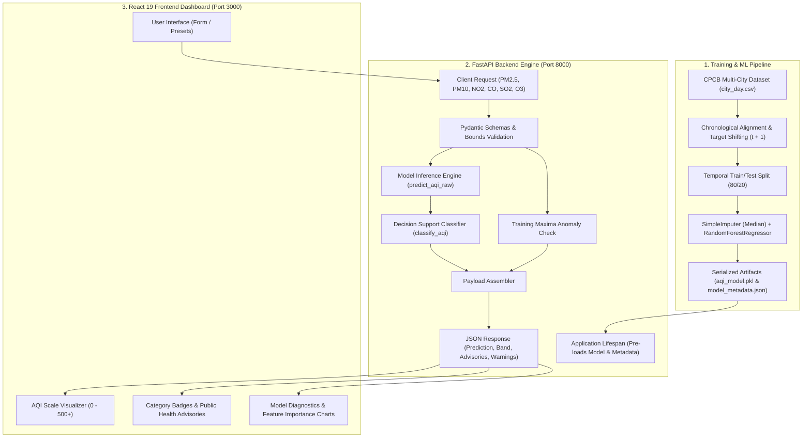

# AI-Powered Air Quality Prediction & Decision Support System (AirSense AI)
## Comprehensive Architecture, Engineering & Methodology Guide

---

## 1. Executive Overview

**AirSense AI** is an end-to-end machine learning and environmental decision-support system designed to forecast the **next calendar day's Air Quality Index (AQI)** using current-day concentrations of six criteria air pollutants.

Unlike standard monitoring tools that only display retrospective or current sensor readings, this project integrates:
1. **Supervised Regression Modeling**: A machine learning pipeline trained on historical multi-city data from the Central Pollution Control Board (CPCB).
2. **Automated Input Guardrails**: Strict boundary checking against historical empirical training maximums.
3. **Deterministic Decision Support**: Rule-based categorization and targeted public health advisories.
4. **Decoupled Modern Web Architecture**: A high-performance **FastAPI** REST backend paired with an interactive **React 19 + TypeScript + Vite** frontend dashboard.



---

## 2. Dataset & Data Engineering Pipeline

### 2.1 Raw Data Source
The system utilizes continuous ambient air quality monitoring station data across 26 major Indian industrial and metropolitan centers (covering 2015 to 2020) compiled by the CPCB:
* **Total raw rows**: 29,531 daily records across 26 cities.
* **Temporal range**: January 1, 2015 through June 30, 2020.

### 2.2 Consecutive Calendar Day Pairing (`t` to `t+1`)
To frame next-day air quality forecasting as a rigorous supervised regression task without data leakage:
1. Records are grouped strictly by `City` and ordered chronologically by `Date`.
2. A forward shift ($t+1$) creates the target:
   $$\text{Target\_AQI}_{i, t} = \text{AQI}_{i, t+1}$$
3. A strict calendar constraint ensures no temporal jumps:
   $$\text{Date}_{t+1} - \text{Date}_t = 1\ \text{day}$$
   Pairs with missing intervening calendar days are filtered out rather than artificially stitched together.
4. Records lacking next-day ground-truth AQI are dropped, yielding **24,849 valid supervised pairs**.

### 2.3 Strict Chronological Train/Test Partitioning
To emulate real-world forecasting where future data is never observed:
* **Train Partition (80%)**: 19,879 records from **2015-01-01** to **2019-12-05**.
* **Test Partition (20%)**: 4,970 records from **2019-12-05** to **2020-06-30** (4,902 matched cases with valid baseline comparisons).
* **Zero Target Leakage**: Imputation statistics (medians) are calculated exclusively on the training partition and frozen for inference.

---

## 3. Machine Learning Architecture & Evaluation

### 3.1 Feature Order & Dimensionality
The model strictly expects 6 criteria pollutants in the following order:

| Feature Name | Chemical / Physical Entity | Official Metric Unit | Training Median Imputation | Historical Training Max |
| :--- | :--- | :--- | :--- | :--- |
| **`PM2.5`** | Fine Particulate Matter ($\le 2.5\ \mu\text{m}$) | $\mu\text{g/m}^3$ | $52.20\ \mu\text{g/m}^3$ | $949.99\ \mu\text{g/m}^3$ |
| **`PM10`** | Inhalable Particulate Matter ($\le 10\ \mu\text{m}$) | $\mu\text{g/m}^3$ | $101.88\ \mu\text{g/m}^3$ | $917.08\ \mu\text{g/m}^3$ |
| **`NO2`** | Nitrogen Dioxide | $\mu\text{g/m}^3$ | $23.81\ \mu\text{g/m}^3$ | $362.21\ \mu\text{g/m}^3$ |
| **`CO`** | Carbon Monoxide | $\text{mg/m}^3$ *(Note: mg, not $\mu$g)* | $0.98\ \text{mg/m}^3$ | $175.81\ \text{mg/m}^3$ |
| **`SO2`** | Sulphur Dioxide | $\mu\text{g/m}^3$ | $9.11\ \mu\text{g/m}^3$ | $186.08\ \mu\text{g/m}^3$ |
| **`O3`** | Ground-Level Ozone | $\mu\text{g/m}^3$ | $30.86\ \mu\text{g/m}^3$ | $257.73\ \mu\text{g/m}^3$ |

### 3.2 Pipeline Composition
The serialized estimator [`aqi_model.pkl`](file:///e:/evs/aqi_model.pkl) encapsulates a two-step Scikit-learn `Pipeline`:
1. **`SimpleImputer(strategy='median')`**: Handles any missing pollutant features in production using the precomputed training medians.
2. **`RandomForestRegressor`**:
   * `n_estimators`: 100 decision trees
   * `min_samples_leaf`: 2 (prevents overfitting to single-station noise)
   * `random_state`: 42 (ensures deterministic reproducibility)
   * `n_jobs`: -1 (parallel tree construction)

### 3.3 Genuine Gini Feature Importance
Analysis of node impurity reduction reveals the model's reliance on each feature:
* **`PM2.5`**: ~44.6% (primary predictive driver across Indian urban airsheds)
* **`PM10`**: ~17.8% (coarse particulate indicator)
* **`NO2`**: ~12.5% (vehicular and combustion marker)
* **`CO`**: ~8.9%
* **`O3`**: ~8.5%
* **`SO2`**: ~7.6%

### 3.4 Model Evaluation vs. Persistence Baseline
The model was evaluated against an un-lagged **Persistence Baseline** (predicting tomorrow's AQI is equal to today's AQI: $\hat{y}_{t+1} = y_t$):

| Metric | Random Forest Model | Persistence Baseline | Improvement |
| :--- | :---: | :---: | :---: |
| **Coefficient of Determination ($R^2$)** | **0.8367** | 0.7724 | **+8.3% variance explained** |
| **Root Mean Squared Error (RMSE)** | **36.46** | 43.05 | **-15.3% error reduction** |
| **Mean Absolute Error (MAE)** | **20.10** | 20.91 | **-3.9% error reduction** |
| **Test Sample Size ($N$)** | 4,902 | 4,902 | Evaluated on identical pairs |

---

## 4. Rule-Based Decision Support System

### 4.1 Methodology: Regression vs. CPCB Breakpoint Sub-Indices
* **CPCB Statutory Calculation**: Calculates individual sub-indices for each monitored pollutant via piecewise linear interpolation across predefined concentration breakpoints, taking the maximum sub-index (requiring at least 3 pollutants with one being PM10 or PM2.5).
* **AirSense AI Empirical Regression**: Predicts the continuous numeric composite AQI directly. The system then deterministically maps this predicted value into standard prototype bands:

```text
  [0 - 50]       Good          Minimal health impact, ideal for outdoor activity.
  [51 - 100]     Satisfactory  Minor breathing discomfort to sensitive individuals.
  [101 - 200]    Moderate      Breathing discomfort to people with lung/heart disease, children.
  [201 - 300]    Poor          Breathing discomfort to most people on prolonged exposure.
  [301 - 400]    Very Poor     Respiratory illness on prolonged exposure; health alert.
  [401 - 500+]   Severe        Emergency condition; serious health impacts across all groups.
```

### 4.2 Deterministic Half-Up Clamping & Rounding
To prevent floating-point boundary jitter (e.g., $100.49$ vs. $100.51$), the decision engine implements standard arithmetic half-up rounding:
$$\text{Effective AQI} = \lfloor \hat{y} + 0.5 \rfloor$$
Negative raw outputs (physically impossible in air pollution) are clamped to $0$ with an informative warning attached to the response.

### 4.3 Training Maxima Guardrails
If any user input exceeds the maximum observed non-null value during the 5-year training period (e.g., $\text{PM}_{2.5} > 949.99\ \mu\text{g/m}^3$), the system does not crash or silently extrapolate; it computes the estimate but appends an explicit warning:
> `"Warning: PM2.5 concentration (1250.0 ug/m3) exceeds the maximum training observation (949.99 ug/m3). Prediction may represent extreme extrapolation."`

---

## 5. Backend Architecture (FastAPI & Uvicorn)

### 5.1 Project Layout
```text
backend/
├── __init__.py
├── main.py              # Application entry point, CORS, routers, exception handlers
├── schemas.py           # Pydantic v2 validation models
├── predictor.py         # Thread-safe pipeline loading, caching & raw inference
├── decision_support.py  # Classification, rounding, and health advisories
└── tests/
    ├── __init__.py
    └── test_api.py      # Automated pytest verification suite
```

### 5.2 Key Endpoints

| Method | Endpoint | Description |
| :--- | :--- | :--- |
| `GET` | `/health` | Reports service health and model deserialization readiness. |
| `GET` | `/model-info` | Exposes model architecture, performance metrics, feature importances, and training bounds. |
| `GET` | `/example` | Returns the ground-truth Visakhapatnam test benchmark case study. |
| `POST` | `/predict` | Ingests pollutant readings, executes inference, checks bounds, and returns decision guidance. |
| `GET` | `/docs` | Interactive Swagger UI documentation. |
| `GET` | `/redoc` | Interactive ReDoc technical specification. |

### 5.3 Cross-Version Compatibility Bridge
In [`backend/predictor.py`](file:///e:/evs/backend/predictor.py#L71-L76), an automated bridge ensures compatibility between models serialized in Scikit-learn 1.5.x and newer production runtime environments:
```python
# Automatically bridge internal attribute changes for SimpleImputer across scikit-learn releases
imputer = pipeline.named_steps.get('imputer')
if imputer is not None and not hasattr(imputer, '_fill_dtype') and hasattr(imputer, '_fit_dtype'):
    imputer._fill_dtype = imputer._fit_dtype
```

---

## 6. Frontend Architecture (React 19, Vite & Tailwind)

### 6.1 Technology Stack
* **Runtime / Framework**: React 19 + TypeScript + Vite.
* **Styling**: Tailwind CSS with custom responsive layout and dark/light accents.
* **Visualizations**: Recharts (for feature importance bar charts and performance distribution).
* **Iconography**: Lucide React.
* **HTTP Client**: Native browser `fetch` with `AbortController` timeout resilience.

### 6.2 Component Hierarchy
* **`Navbar`**: Persistent branding, navigation tabs, and a real-time heartbeat indicator polling `GET /health` every 15 seconds.
* **`Dashboard` Page**:
  * Real-time connectivity status banner.
  * 4 performance metric stat cards ($R^2$, $\text{RMSE}$, $\text{MAE}$, $N=4,902$).
  * Feature importance breakdown preview.
  * Benchmark case study showcase (Visakhapatnam evaluation).
  * System architecture workflow diagram.
* **`PredictPage`**:
  * Input forms for all 6 pollutants with field-level bounds ($[0, \infty)$).
  * Quick preset selectors (**Baseline Test**, **Clean Air**, **Moderate City**, **Industrial Pollution**).
  * Dynamic visual AQI gauge scale (0 to 500+).
  * Color-coded category badge and rule-based public health bullet points.
  * Real-time training boundary alert badges.
* **`ModelMethodologyPage`**:
  * Comprehensive academic documentation, data partition statistics, CPCB methodology comparison, and statutory disclaimers.

---

## 7. Local Deployment & Run Instructions

### 7.1 Prerequisites
* Python 3.10+ (tested on Python 3.11)
* Node.js v18+ (tested on Node v24)

### 7.2 Running the Backend (Port 8000)
```powershell
# From the project root (e:\evs)
# 1. Activate the virtual environment
.\venv\Scripts\Activate.ps1

# 2. Run automated test suite
pytest backend/tests/test_api.py -v

# 3. Start the FastAPI server
uvicorn backend.main:app --host 127.0.0.1 --port 8000
```
* Interactive Swagger Docs: [http://127.0.0.1:8000/docs](http://127.0.0.1:8000/docs)
* Health Status: [http://127.0.0.1:8000/health](http://127.0.0.1:8000/health)

### 7.3 Running the Frontend (Port 3000)
```powershell
# From the frontend directory (e:\evs\frontend)
# 1. Start the Vite development server
npm run dev
```
* Dashboard URL: [http://localhost:3000](http://localhost:3000)

---

## 8. Academic Context, Limitations & Disclaimers

1. **Empirical Regression vs. Statutory Certification**:
   The model produces an empirical statistical estimate for next-day planning. It is not an official legal certification or statutory compliance calculation as defined by environmental regulatory authorities.
2. **Concept Drift Notice**:
   Because the test partition spans the spring 2020 COVID-19 nationwide lockdown, baseline emissions patterns underwent drastic shifts, which is documented in the methodology section.
3. **Medical Disclaimer**:
   Public health advisories generated by the decision support engine are for educational and advisory purposes and do not replace personalized guidance from medical practitioners.
