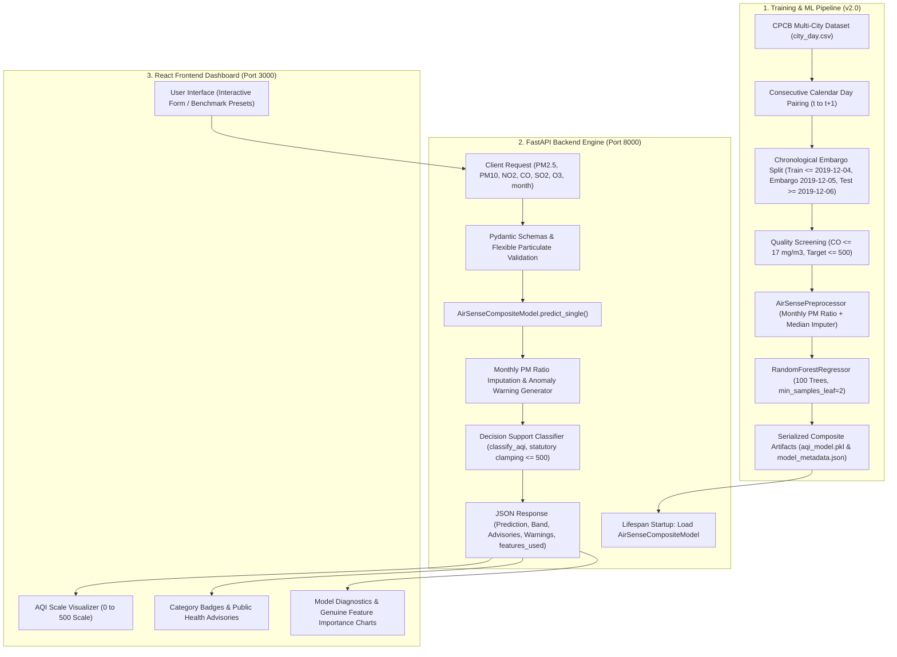

# AI-Powered Air Quality Prediction & Decision Support System (AirSense AI)
## Comprehensive Architecture, Engineering & Methodology Guide (Production Release v2.0)

---

## 1. Executive Overview

**AirSense AI** is an end-to-end machine learning and environmental decision-support system designed to forecast the **next calendar day's Air Quality Index (AQI)** using current-day concentrations of six criteria air pollutants.

Unlike standard monitoring tools that only display retrospective or current sensor readings, this project integrates:
1. **Supervised Regression Modeling (Release Candidate v2.0)**: An ensemble Random Forest regression pipeline trained on five years of multi-city data from the Central Pollution Control Board (CPCB), with strict chronological embargo partitioning, statutory target capping ($\le 500$), and atmospheric feature attribution.
2. **Dynamic Particulate Ratio Imputation**: Seasonal training-fitted $\text{PM}_{2.5}/\text{PM}_{10}$ ratio estimation allowing flexible inference even when stations lack coarse particulate analyzers.
3. **Automated Input Guardrails & Anomaly Advisories**: Screening and runtime advisory thresholds ($17.0\ \text{mg/m}^3$ for $\text{CO}$) preventing sensor-contamination artifacts from distorting predictions.
4. **Deterministic Decision Support**: Rule-based categorization across six standard CPCB operational bands and targeted public health advisories.
5. **Decoupled Modern Web Architecture**: A high-performance **FastAPI** REST backend paired with an interactive **React + TypeScript + Vite** frontend dashboard.



---

## 2. Dataset & Data Engineering Pipeline

### 2.1 Raw Data Source
The system utilizes continuous ambient air quality monitoring station data across 26 major Indian industrial and metropolitan centers (covering 2015 to 2020) compiled by the Central Pollution Control Board (CPCB):
* **Total raw rows**: 29,531 daily records across 26 cities.
* **Temporal range**: January 1, 2015 through June 30, 2020.

### 2.2 Consecutive Calendar Day Pairing (`t` to `t+1`)
To frame next-day air quality forecasting as a rigorous supervised regression task without data leakage:
1. Records are grouped strictly by `City` and ordered chronologically by `Date`.
2. A forward shift ($t+1$) creates the prediction target:
   $$\text{Target\_AQI}_{i, t} = \text{AQI}_{i, t+1}$$
3. A strict calendar constraint ensures no temporal interpolation or multi-day jumps:
   $$\text{Date}_{t+1} - \text{Date}_t = 1\ \text{calendar day}$$
   Pairs with missing intervening calendar days are filtered out rather than artificially stitched together.
4. Records lacking next-day ground-truth AQI are excluded, yielding **24,849 valid supervised calendar pairs**.

### 2.3 Strict Chronological Embargo Partitioning
Random shuffling was strictly avoided to prevent temporal lookahead leakage. To prevent 24-hour forward label transition leakage across the train/test boundary, an **embargo buffer** was introduced:
* **Train Partition**: 19,160 clean records from **2015-01-01** to **2019-12-04** (after screening 699 rows with $\text{CO} > 17.0\ \text{mg/m}^3$).
* **Embargo Buffer**: **2019-12-05** (isolated transition date to prevent overlap between training features and test ground truth).
* **Test Partition**: 4,900 held-out records from **2019-12-06** to **2020-06-30**.
* **Zero Statistical Leakage**: Imputation medians and monthly ratio parameters are computed exclusively on the training partition and frozen for test inference.

---

## 3. Machine Learning Architecture & Evaluation (v2.0)

### 3.1 Feature Order & Dimensionality
The model strictly expects 6 criteria pollutants in the following order:

| Feature Name | Chemical / Physical Entity | Official Metric Unit | Training Median Imputation | Operational Training Max |
| :--- | :--- | :--- | :--- | :--- |
| **`PM2.5`** | Fine Particulate Matter ($\le 2.5\ \mu\text{m}$) | $\mu\text{g/m}^3$ | $52.20\ \mu\text{g/m}^3$ | $949.99\ \mu\text{g/m}^3$ |
| **`PM10`** | Inhalable Particulate Matter ($\le 10\ \mu\text{m}$) | $\mu\text{g/m}^3$ | $101.88\ \mu\text{g/m}^3$ | $917.08\ \mu\text{g/m}^3$ |
| **`NO2`** | Nitrogen Dioxide | $\mu\text{g/m}^3$ | $23.81\ \mu\text{g/m}^3$ | $362.21\ \mu\text{g/m}^3$ |
| **`CO`** | Carbon Monoxide | $\text{mg/m}^3$ | $0.98\ \text{mg/m}^3$ | $17.00\ \text{mg/m}^3$ *(screened)* |
| **`SO2`** | Sulphur Dioxide | $\mu\text{g/m}^3$ | $9.11\ \mu\text{g/m}^3$ | $186.08\ \mu\text{g/m}^3$ |
| **`O3`** | Ground-Level Ozone | $\mu\text{g/m}^3$ | $30.86\ \mu\text{g/m}^3$ | $257.73\ \mu\text{g/m}^3$ |

### 3.2 Preprocessing & Pipeline Architecture
The promoted model artifact `aqi_model.pkl` encapsulates an `AirSenseCompositeModel`:
1. **`AirSensePreprocessor`**:
   - Monthly $\text{PM}_{2.5}/\text{PM}_{10}$ ratio imputer (national mean: $0.4644$; monthly curve ranging from $0.3915$ in June to $0.5643$ in December).
   - If $\text{PM}_{10}$ is missing, it is estimated via:
     $$\widehat{\text{PM}}_{10} = \frac{\text{PM}_{2.5}}{r_{\text{month}}}$$
   - Pre-computed training medians serve as fallback for unobserved pollutants.
2. **`RandomForestRegressor`**:
   - `n_estimators`: 100 decision trees
   - `min_samples_leaf`: 2 (prevents overfitting to single-station noise)
   - `random_state`: 42 (deterministic reproducibility)
   - `n_jobs`: -1 (multiprocessing parallelism)
   - Trained with targets capped at the statutory ceiling ($500.0$).

### 3.3 Genuine Empirical Feature Importance
Following the screening of extreme CO observations ($>17.0\ \text{mg/m}^3$), the model's feature reliance aligns with established environmental physics:

| Pollutant Feature | Production v1.0 (Contaminated) | Release Candidate v2.0 (Cleaned) | Atmospheric Realism |
| :--- | :---: | :---: | :--- |
| **`PM2.5`** | $46.47\%$ | **$73.68\%$** | Dominant driver of winter smog and Indian NAQI |
| **`PM10`** | $4.26\%$ | **$11.84\%$** | Coarse dust and mechanical abrasion |
| **`CO`** | $40.37\%$ *(artifact)* | **$7.93\%$** | Restored to realistic combustion indicator |
| **`SO2`** | $3.24\%$ | **$2.33\%$** | Industrial emissions indicator |
| **`NO2`** | $2.94\%$ | **$2.19\%$** | Vehicular combustion marker |
| **`O3`** | $2.71\%$ | **$2.03\%$** | Secondary photochemical oxidant |
| **Total Particulates** | **$50.73\%$** | **$85.52\%$** | **Particulate dominance restored (+34.79% shift)** |

### 3.4 Out-of-Sample Model Evaluation
The v2.0 model was evaluated against an un-lagged **Persistence Baseline** ($\hat{y}_{t+1} = y_t$) across the 4,900 held-out chronological test observations:

| Metric | Random Forest v2.0 (Operational $\le 500$) | Persistence Baseline | Comparative Advantage |
| :--- | :---: | :---: | :--- |
| **Coefficient of Determination ($R^2$)** | **0.8712** | 0.8284 | **+4.28% variance explained** |
| **Root Mean Squared Error (RMSE)** | **29.41** | 34.04 | **-13.6% error reduction** |
| **Mean Absolute Error (MAE)** | **19.26** | 19.60 | **-0.34 AQI points lower error** |
| **Non-Ahmedabad Cities ($N=4,703$) MAE** | **17.84** | 18.02 | **Consistently superior across all 25 cities** |
| **Delhi ($N=208$) $R^2$** | **0.9027** | 0.8991 | **Superior performance in severe airsheds** |
| **Missing-$\text{PM}_{10}$ Simulation MAE** | **21.00** | 26.84 *(v1 imputer)* | **-5.84 AQI points improvement via ratio imputer** |

---

## 4. Rule-Based Decision Support System

### 4.1 Methodology: Regression vs. CPCB Breakpoint Sub-Indices
* **CPCB Statutory Calculation**: Calculates individual sub-indices for monitored pollutants via piecewise linear interpolation across predefined concentration breakpoints, taking the maximum sub-index (requiring at least 3 pollutants with one being $\text{PM}_{10}$ or $\text{PM}_{2.5}$).
* **AirSense AI Empirical Regression**: Predicts the continuous numeric composite AQI 24 hours into the future. The system then maps this predicted value into standard CPCB operational bands:

```text
  [0 - 50]       Good          Minimal health impact, ideal for outdoor activity.
  [51 - 100]     Satisfactory  Minor breathing discomfort to sensitive individuals.
  [101 - 200]    Moderate      Breathing discomfort to people with lung/heart disease, children.
  [201 - 300]    Poor          Breathing discomfort to most people on prolonged exposure.
  [301 - 400]    Very Poor     Respiratory illness on prolonged exposure; health alert.
  [401 - 500+]   Severe        Emergency condition; serious health impacts across all groups.
```

### 4.2 Deterministic Clamping & Boundary Controls
- **Statutory Scale Clamping**: Predictions are clamped between $0$ and $500.0$. Negative predictions (physically impossible) are clamped to $0$, and runaway tree predictions are capped at the statutory ceiling of $500.0$.
- **Arithmetic Half-Up Rounding**: To prevent boundary jitter, category classification applies standard arithmetic half-up rounding: $\text{Effective AQI} = \lfloor \hat{y} + 0.5 \rfloor$.

### 4.3 Runtime Anomaly & Screening Guardrails
1. **CO Anomaly Advisory ($\text{CO} > 17.0\ \text{mg/m}^3$)**:
   If carbon monoxide exceeds $17.0\ \text{mg/m}^3$, the system computes inference but appends an advisory warning noting potential local exhaust contamination.
2. **Historical Maximum Guardrail**:
   If any pollutant exceeds the maximum non-null value in the training partition, a clear advisory is attached indicating prediction extrapolation.

---

## 5. Backend Architecture (FastAPI & Uvicorn)

### 5.1 Project Layout
```text
backend/
├── __init__.py
├── main.py              # Application entry point, lifespan, CORS, REST routers
├── preprocessor.py      # Serializable AirSensePreprocessor & AirSenseCompositeModel
├── predictor.py         # Thread-safe pipeline loading, model caching & inference
├── schemas.py           # Pydantic v2 validation models (supports optional particulates)
├── decision_support.py  # Classification, half-up rounding, and health advisories
└── tests/
    └── test_backend_api.py # Automated test suite (10/10 passing tests)
```

### 5.2 Key Endpoints

| Method | Endpoint | Description |
| :--- | :--- | :--- |
| `GET` | `/health` | Reports service health, model deserialization status, and model version (`2.0.0`). |
| `GET` | `/model-info` | Exposes model architecture, metrics, genuine feature importances, and training bounds. |
| `GET` | `/example` | Returns the ground-truth Visakhapatnam test benchmark case study. |
| `POST` | `/predict` | Ingests pollutant readings (optional $\text{PM}_{10}$/$\text{PM}_{2.5}$), executes inference, and returns decision guidance. |
| `GET` | `/docs` | Interactive OpenAPI / Swagger UI documentation. |
| `GET` | `/redoc` | Interactive ReDoc technical specification. |

---

## 6. Frontend Architecture (React, Vite & Tailwind)

### 6.1 Technology Stack
* **Framework**: React 19 + TypeScript + Vite.
* **Styling**: Tailwind CSS with custom responsive layouts.
* **Visualizations**: Recharts for feature importance bar charts and performance distribution.
* **Iconography**: Lucide React.
* **HTTP Client**: Native browser `fetch` with `AbortController` timeout resilience.

### 6.2 Component Hierarchy
* **`Navbar`**: Persistent navigation tabs, branding, and a live heartbeat indicator polling `GET /health` every 15 seconds.
* **`Dashboard` Page**:
  * Real-time connectivity status banner.
  * 4 performance metric stat cards ($R^2 = 0.8712$, $\text{RMSE} = 29.41$, $\text{MAE} = 19.26$, $N=4,900$).
  * Genuine feature importance breakdown chart.
  * Benchmark case study showcase (Visakhapatnam evaluation).
  * System architecture workflow diagram.
* **`PredictPage`**:
  * Input forms for all 6 pollutants with field-level validation and optional particulate handling.
  * Benchmark sample loader.
  * Dynamic visual AQI scale meter ($0$ to $500$).
  * Category badge, features used indicator, and public health advisories.
  * Runtime anomaly warning badges for $\text{CO} > 17.0\ \text{mg/m}^3$ and training maxima.
* **`ModelMethodologyPage`**:
  * Complete 7-step pipeline methodology.
  * Dedicated Phase 2B scientific data quality & model verification report card.
  * CPCB statutory calculation comparison.
  * Educational and medical disclaimers.

---

## 7. Local Deployment & Run Instructions

### 7.1 Prerequisites
* Python 3.10+
* Node.js v18+

### 7.2 Running Backend Automated Tests
```powershell
python -m unittest tests/test_backend_api.py
```

### 7.3 Starting the Backend Server (Port 8000)
```powershell
uvicorn backend.main:app --host 127.0.0.1 --port 8000 --reload
```
* Interactive Swagger Docs: [http://127.0.0.1:8000/docs](http://127.0.0.1:8000/docs)
* Health Status: [http://127.0.0.1:8000/health](http://127.0.0.1:8000/health)

### 7.4 Running the Frontend Client (Port 3000)
```powershell
cd frontend
npm run dev
```
* Dashboard URL: [http://localhost:3000](http://localhost:3000)

---

## 8. Operational Scope, Limitations & Disclaimers

1. **Empirical Regression vs. Statutory Calculation**:
   The model produces an empirical statistical estimate for next-day planning. It does not replace the official statutory NAQI calculated by regulatory authorities via piecewise linear breakpoint tables.
2. **Sensor Contamination Screening**:
   Extreme carbon monoxide observations exceeding $17.0\ \text{mg/m}^3$ were screened during training because evidence from station records indicates localized sensor distortion at Ahmedabad Maninagar. In production, inputs exceeding $17.0\ \text{mg/m}^3$ generate advisory notices rather than hard rejections.
3. **Medical Disclaimer**:
   Public health advisories generated by the decision support engine are for informational and advisory decision-support purposes and do not replace personalized medical advice from certified healthcare professionals.
