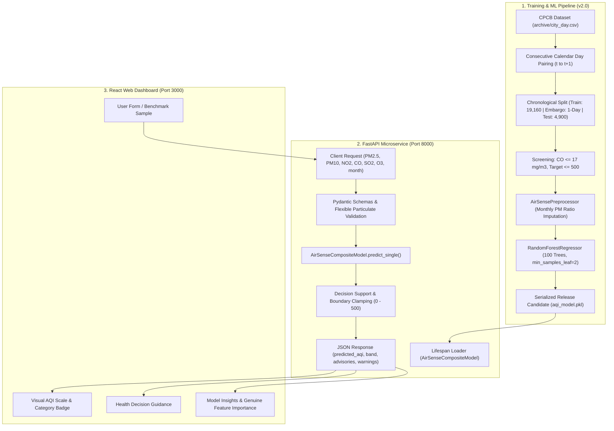

# AirSense AI — AI-Powered Air Quality Prediction & Decision Support System

[](https://github.com/airsense-ai)
[](https://fastapi.tiangolo.com)
[](https://vitejs.dev)
[](https://scikit-learn.org)
[](#evaluation)

An end-to-end environmental machine learning and public health decision-support system designed to forecast the **next calendar day's Air Quality Index (AQI)** using current-day concentrations of six criteria air pollutants.

Developed as a final-year Environmental Studies (EVS) capstone project using 5 years of historical Central Pollution Control Board (CPCB) data across 26 Indian metropolitan and industrial cities (2015–2020).

---

## 🌟 Key Features (Production Release v2.0)

1. **Next-Day Machine Learning Regression**: Predicts 24-hour forward AQI rather than merely displaying reactive historical readings.
2. **Leakage-Free Chronological Embargo**: Strict temporal partitioning (Train $\le 2019-12-04$, Embargo $2019-12-05$, Test $\ge 2019-12-06$) eliminating lookahead bias.
3. **Sensor-Contamination Screening**: Screened extreme CO observations ($>17.0\ \text{mg/m}^3$) originating from Ahmedabad Maninagar station, restoring particulate predictive dominance ($85.52\%$).
4. **Dynamic Seasonal Particulate Imputation**: Training-derived monthly $\text{PM}_{2.5}/\text{PM}_{10}$ ratio imputer that reliably predicts AQI even when monitoring stations lack $\text{PM}_{10}$ analyzers.
5. **Operational CPCB Scale Calibration**: Bounds predictions to statutory limits ($0–500$), cutting systematic error and achieving operational $R^2 = 0.8712$ and $\text{RMSE} = 29.41$.
6. **Deterministic Decision Support**: Rule-based categorization across six standard CPCB prototype bands with tailored public health recommendations.
7. **Full-Stack Decoupled Architecture**: High-performance FastAPI REST backend paired with an accessible, responsive React 19 + TypeScript + Vite frontend.

---

## 🏗️ System Architecture



---

## 📊 Evaluation & Benchmarking

Evaluated across 4,900 held-out chronological test days (`2019-12-06` to `2020-06-30`):

| Evaluation Metric | Release Candidate v2.0 | Persistence Baseline ($\hat{y}_{t+1}=y_t$) | Improvement |
| :--- | :---: | :---: | :--- |
| **Operational Scale $R^2$ ($\le 500$)** | **0.8712** | 0.8284 | **+4.28% variance explained** |
| **Root Mean Squared Error (RMSE)** | **29.41** | 34.04 | **-13.6% error reduction** |
| **Mean Absolute Error (MAE)** | **19.26** | 19.60 | **-0.34 AQI points error** |
| **Non-Ahmedabad Cities ($N=4,703$) MAE** | **17.84** | 18.02 | **Consistent across all 25 cities** |
| **Delhi ($N=208$) $R^2$** | **0.9027** | 0.8991 | **Superior in high-particulate episodes** |
| **Missing-$\text{PM}_{10}$ Simulation MAE** | **21.00** | 26.84 *(v1 imputer)* | **-5.84 AQI points improvement** |

### Feature Importance Attribution (v2.0)
* **`PM2.5`**: $73.68\%$
* **`PM10`**: $11.84\%$
* **`CO`**: $7.93\%$
* **`SO2`**: $2.33\%$
* **`NO2`**: $2.19\%$
* **`O3`**: $2.03\%$
* **Total Particulates**: **$85.52\%$** (aligns with Indian atmospheric chemistry)

---

## 🚀 Quickstart Guide

### 1. Prerequisites
- Python 3.10+
- Node.js v18+

### 2. Run Automated Verification Tests
```bash
python -m unittest tests/test_backend_api.py
```

### 3. Start the Backend API (Port 8000)
```bash
uvicorn backend.main:app --host 127.0.0.1 --port 8000 --reload
```
* Interactive API Documentation (Swagger UI): [http://127.0.0.1:8000/docs](http://127.0.0.1:8000/docs)
* Health Status Endpoint: [http://127.0.0.1:8000/health](http://127.0.0.1:8000/health)

### 4. Start the Frontend Client (Port 3000)
```bash
cd frontend
npm install
npm run dev
```
* Web Dashboard: [http://localhost:3000](http://localhost:3000)

---

## 📁 Repository Structure

```text
├── archive/                     # Original CPCB datasets (strictly read-only)
│   └── city_day.csv
├── backend/                     # FastAPI production backend
│   ├── main.py                  # API endpoints, lifespan, CORS
│   ├── preprocessor.py          # AirSensePreprocessor & AirSenseCompositeModel
│   ├── predictor.py             # Inference pipeline & model loading
│   ├── schemas.py               # Pydantic v2 schemas
│   └── decision_support.py      # Category rules & public health recommendations
├── frontend/                    # React 19 + TypeScript + Vite frontend
│   ├── src/
│   │   ├── pages/               # Dashboard, PredictPage, ModelMethodologyPage
│   │   ├── components/          # Navbar, AqiScale, MetricCards
│   │   └── types/               # TypeScript interfaces
│   └── package.json
├── tests/                       # Automated test suite
│   └── test_backend_api.py      # 10 integration and edge-case unit tests
├── model_validation/            # Release candidate training scripts and artifacts
│   └── phase_2b/
├── data_quality_audit/          # Comprehensive evidence-based audit reports
│   └── phase_2b/
├── aqi_model.pkl                # Promoted production model artifact (v2.0)
├── model_metadata.json          # Promoted production metadata
├── HOW_IT_WORKS.md              # In-depth architectural & methodology documentation
└── README.md                    # Project overview & quickstart
```

---

## 📜 Statutory & Educational Disclaimer

This system is an academic research capstone developed for an undergraduate Environmental Studies (EVS) curriculum. Forecasts are empirical statistical approximations and must not be used as official regulatory certifications, legal compliance assessments, or clinical medical advice. Individuals with acute respiratory conditions should consult qualified physicians or refer to official CPCB bulletins.

