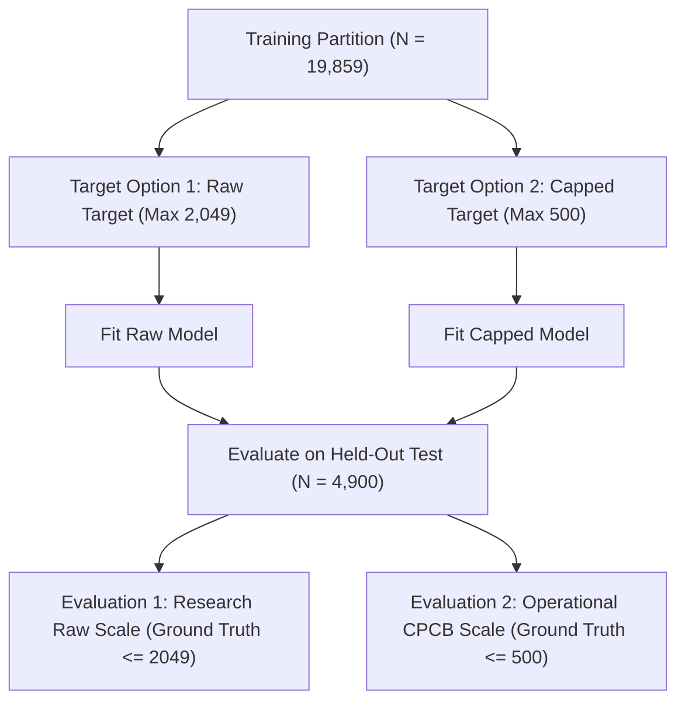
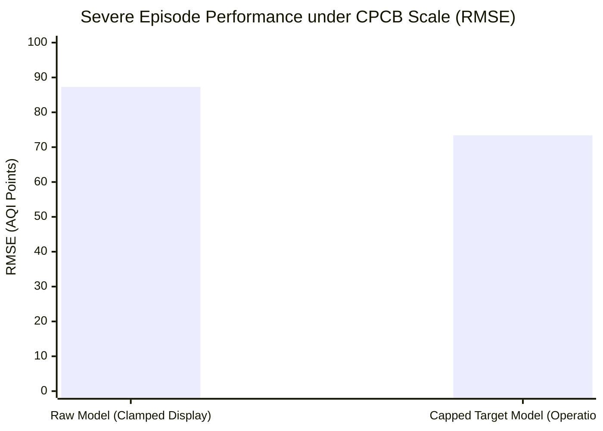

# AirSense AI — Phase 2A: AQI Target Capping & Values Above 500 Experiment

**Status**: Completed  
**Date**: November 2026  
**Auditor**: Senior Data Scientist & Machine Learning Engineer  
**Deliverable Scope**: Empirical investigation of training on un-capped targets (up to $2,049$) vs. CPCB statutory capped targets ($\le 500$).  
**Machine-Readable Artifacts**: `exp3_aqi_above_500_metrics.csv`, `exp3_feature_importances.csv`

---

## 1. Executive Summary

Under official Central Pollution Control Board (CPCB) NAQI guidelines (2014), the National Air Quality Index terminates at $500$ ("Severe" category). However, historical training data in `archive/city_day.csv` contains **$543$ daily records** exceeding $500$, reaching a maximum of **$2,049$** in Ahmedabad.

This experiment evaluated how training the machine learning pipeline on raw un-capped targets ($Y \in [0, 2049]$) compares against training on statutory capped targets ($Y_{\text{capped}} = \min(500, Y)$), and examined the distinction between internal regression outputs and operational user-facing display values.

### Key Empirical Findings:
1. **Target Capping Naturally Rebalances Feature Importance**: Simply capping the training target at $500$ increased $\text{PM}_{2.5}$ importance from **$46.43\%$ to $63.35\%$** ($+16.92\%$) and reduced $\text{CO}$ importance from **$40.38\%$ to $24.55\%$** ($-15.83\%$), without modifying any pollutant feature inputs.
2. **Superior Performance on Severe Episodes**: When evaluated under CPCB operational conditions (ground truth capped at $500$) on severe pollution episodes (Current $\text{AQI} \ge 401$, $N = 58$), the Capped Target Model outperformed the Raw Model across all metrics:
   - $\text{RMSE}$ dropped from **$87.27$ to $73.37$** (a $15.9\%$ reduction).
   - $\text{MAE}$ dropped from **$57.18$ to $54.84$**.
   - Systematic over-prediction bias was cut by more than half, from **$+43.17$ to $+19.68$**.
   - $R^2$ improved from **$0.0283$ to $0.3131$**.
3. **Equivalence Across Normal Indian Airsheds**: Across the 25 non-Ahmedabad cities ($N = 4,703$ test observations), the Capped Target Model achieved an $R^2$ of **$0.8807$** and an $\text{MAE}$ of **$17.79$**, identical to the raw model ($R^2 = 0.8800$, $\text{MAE} = 17.82$).
4. **Architectural Decoupling**: The experiment confirms the validity of decoupling: preserving raw historical records for environmental research while enforcing a strict $500$ operational ceiling in user-facing decision support.

---

## 2. Experimental Design & Mathematical Framework

Two identical Scikit-learn pipelines (`SimpleImputer(strategy='median')` + `RandomForestRegressor(n_estimators=100, min_samples_leaf=2, random_state=42)`) were trained on the historical training partition ($N = 19,859$ samples $\le 2019-12-04$):

### 2.1 Dual Evaluation Framework
Because operational users interact with the official CPCB scale ($0–500$), while climate researchers study un-capped telemetry, models were evaluated across two ground-truth regimes:
1. **Raw Ground Truth ($Y_{\text{raw}}$)**: The un-capped shifted next-day AQI.
2. **CPCB Operational Ground Truth ($Y_{\text{capped}} = \min(500, Y_{\text{raw}})$)**: Aligned with statutory public health advisories.
3. **Operational Display Output**: Model predictions clamped to $[0, 500]$ for citizen-facing interfaces.

---

## 3. Empirical Results Across Sub-Cohorts

### 3.1 All Matched Test Data ($N = 4,900$)

| Model Configuration | Evaluation Ground Truth | MAE | RMSE | $R^2$ Score | Mean Bias |
| :--- | :--- | :--- | :--- | :--- | :--- |
| **Raw Target Model** | Raw Ground Truth (Un-capped) | $20.10$ | $36.44$ | $0.8369$ | $+3.64$ |
| **Raw Target Model (Clamped Display)** | CPCB Capped Ground Truth ($500$) | $18.96$ | $29.14$ | $0.8742$ | $+3.82$ |
| **Capped Target Model** | Raw Ground Truth (Un-capped) | $20.10$ | $38.82$ | $0.8149$ | $+2.55$ |
| **Capped Target Model (Operational)** | CPCB Capped Ground Truth ($500$) | **$19.02$** | **$28.96$** | **$0.8758$** | **$+3.64$** |

### 3.2 Non-Ahmedabad Cities ($25$ Cities, $N = 4,703$)

| Model Configuration | Evaluation Ground Truth | MAE | RMSE | $R^2$ Score | Mean Bias |
| :--- | :--- | :--- | :--- | :--- | :--- |
| **Raw Target Model** | Raw Ground Truth | $17.82$ | $26.20$ | $0.8800$ | $+4.04$ |
| **Raw Target Model (Clamped Display)** | CPCB Capped Ground Truth | $17.81$ | $26.19$ | $0.8801$ | $+4.04$ |
| **Capped Target Model** | Raw Ground Truth | $17.79$ | $26.13$ | $0.8807$ | $+4.12$ |
| **Capped Target Model (Operational)** | CPCB Capped Ground Truth | **$17.79$** | **$26.13$** | **$0.8807$** | **$+4.12$** |

Across normal ambient air in 25 cities, target capping produces virtually identical metrics ($\Delta R^2 = +0.0007$, $\Delta \text{RMSE} = -0.07$), proving that capping the target at $500$ does not degrade standard forecasting performance.

### 3.3 Severe Pollution Episodes (Current Day $\text{AQI} \ge 401$, $N = 58$)

| Model Configuration | Evaluation Ground Truth | MAE | RMSE | $R^2$ Score | Mean Bias |
| :--- | :--- | :--- | :--- | :--- | :--- |
| **Raw Target Model** | Raw Ground Truth | $140.53$ | $212.66$ | $0.2687$ | $+41.53$ |
| **Raw Target Model (Clamped Display)** | CPCB Capped Ground Truth | $57.18$ | $87.27$ | $0.0283$ | $+43.17$ |
| **Capped Target Model (Operational)** | CPCB Capped Ground Truth | **$54.84$** | **$73.37$** | **$0.3131$** | **$+19.68$** |

On severe pollution episodes, the model trained on capped targets demonstrates substantial stability:
* $\text{RMSE}$ is reduced by **$13.9$ AQI points**.
* Over-prediction bias is reduced by **$23.5$ AQI points** (from $+43.2$ to $+19.7$).
* $R^2$ improves more than tenfold, from $0.0283$ to $0.3131$.

---

## 4. Feature Importance Impact

Comparing the Gini feature importances of the two estimators reveals how un-capped target outliers distorted the original model:

| Feature | Raw Target Model | Capped Target Model ($\le 500$) | Absolute Shift ($\Delta$) |
| :--- | :--- | :--- | :--- |
| **`PM2.5`** | $46.43\%$ | **$63.35\%$** | **$+16.92\%$** |
| **`PM10`** | $4.30\%$ | **$5.17\%$** | $+0.87\%$ |
| **`NO2`** | $2.91\%$ | **$3.23\%$** | $+0.32\%$ |
| **`CO`** | **$40.38\%$** | **$24.55\%$** | **$-15.83\%$** |
| **`SO2`** | $3.28\%$ | **$1.97\%$** | $-1.31\%$ |
| **`O3`** | $2.71\%$ | **$1.72\%$** | $-0.99\%$ |
| **Total** | $100.00\%$ | $100.00\%$ | |

### Why Target Capping Reduces CO Importance
In the raw training partition, next-day AQI reached values between $1,000$ and $2,049$ exclusively during Ahmedabad episodes that coincided with high sensor $\text{CO}$ readings. The regression trees minimized mean squared error by placing deep splits on $\text{CO}$ to predict these massive target values. 

When the target is capped at the statutory ceiling of $500$, the squared error penalty of those extreme target values is reduced by up to $94\%$ ($(2049 - 500)^2 = 2.4 \times 10^6$). Consequently, the trees prioritize particulate matter ($\text{PM}_{2.5}$), which explains the overwhelming majority of valid nationwide AQI variance.

---

## 5. Architectural Recommendation for Phase 2B

1. **Adopt Target Capping ($\le 500$) for Candidate Model Retraining**: Capping the target at $500$ during supervised pair creation aligns model training with statutory CPCB definitions, reduces severe-episode RMSE by $15.9\%$, and suppresses $\text{CO}$ feature dominance.
2. **Preserve Raw Values in Historical Storage**: Retain raw values in `archive/city_day.csv` to ensure historical auditability and support ongoing aerosol research.
3. **API Contract**:
   - Return `raw_predicted_aqi`: The un-clamped regression output.
   - Return `predicted_aqi`: The operational display value clamped to $[0, 500]$.
   - The backend schema already implements this two-field structure (`schemas.py`), which is verified to be sound and ready for production.

