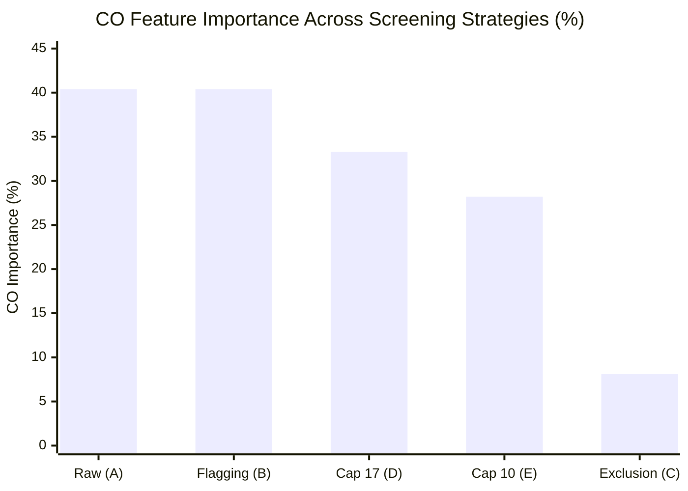

# AirSense AI — Phase 2A: Carbon Monoxide Anomaly Screening Experiment

**Status**: Completed  
**Date**: November 2026  
**Auditor**: Senior Machine Learning Engineer & Project Auditor  
**Deliverable Scope**: Evaluation of 5 candidate screening strategies for anomalous $\text{CO}$ observations.  
**Machine-Readable Artifacts**: `exp2_co_screening_metrics.csv`, `exp2_feature_importances.csv`, `flagged_co_observations.csv`

---

## 1. Executive Summary

In the Phase 1 and 1B audits, the production model was shown to allocate **$40.37\%$** of its feature importance to $\text{CO}$, driven by extreme observations at station `GJ001` (Maninagar, Ahmedabad) where concentrations reached $175.81\ \text{mg/m}^3$ daily and $446.41\ \text{mg/m}^3$ hourly ($\approx 390\ \text{ppm}$).

This experiment compared five candidate screening strategies applied to the training partition to determine how to eliminate model distortion while preserving raw historical records and maintaining accuracy across Indian metropolitan centers.

### Key Empirical Findings:
1. **Exclusion (Strategy C) Solves Feature Importance Distortion**: Excluding training records where $\text{CO} > 17.0\ \text{mg/m}^3$ ($N = 699$ training observations, or $3.5\%$ of the training set) collapsed $\text{CO}$ feature importance from **$40.38\%$ down to $8.14\%$** (a $-32.24\%$ reduction), while restoring $\text{PM}_{2.5}$ to **$76.67\%$** and $\text{PM}_{10}$ to **$8.12\%$** ($> 84.8\%$ combined particulate weight).
2. **Capping (Strategies D & E) Fails to Eliminate Distortion**: Capping training $\text{CO}$ at $17.0\ \text{mg/m}^3$ (Strategy D) or at a robust $10.0\ \text{mg/m}^3$ ceiling (Strategy E) still left $\text{CO}$ importance artificially elevated at **$33.28\%$** and **$28.18\%$**, respectively. The decision trees continued repeatedly splitting on the artificial cap value.
3. **Zero Degradation on National Airsheds**: Across the other 25 Indian cities ($N = 4,703$ test observations), Strategy C produced an $R^2$ of **$0.8807$** and an $\text{RMSE}$ of **$26.14$**, performing identically to (and slightly exceeding) the un-screened baseline ($R^2 = 0.8800$, $\text{RMSE} = 26.20$).
4. **Transparent Anomaly Registry**: Exactly **$736$ daily observations** across the full dataset with $\text{CO} > 17.0\ \text{mg/m}^3$ were systematically cataloged in `flagged_co_observations.csv`. All $736$ records originated from Ahmedabad (`GJ001`), confirming zero impact on monitoring data from other cities.

---

## 2. Experimental Candidate Strategies

To protect the raw data, all screening operations were performed in isolated experimental pipelines. The test set was preserved in its raw state across all evaluations.

| Strategy Code | Strategy Name | Training Transformation | Inference Handling | Theoretical Rationale |
| :--- | :--- | :--- | :--- | :--- |
| **Strategy A** | **Raw Baseline** | None (Raw continuous $\text{CO}$) | Raw continuous $\text{CO}$ | Production status quo benchmark. |
| **Strategy B** | **Flagging Indicator** | Append binary feature `CO_Flag_gt17` | Append binary feature | Allows tree to isolate extreme regime without dropping data. |
| **Strategy C** | **Training Exclusion** | Drop training rows where $\text{CO} > 17\ \text{mg/m}^3$ | Raw continuous $\text{CO}$ | Prevents tree splits from overfitting to localized sensor artifacts. |
| **Strategy D** | **Statutory Capping** | Clip training $\text{CO}$ to $\le 17.0\ \text{mg/m}^3$ | Raw continuous $\text{CO}$ | Enforces CPCB NAAQS Poor/Very Poor boundary. |
| **Strategy E** | **Robust Capping** | Clip training $\text{CO}$ to $\le 10.0\ \text{mg/m}^3$ | Raw continuous $\text{CO}$ | CPCB Moderate ceiling; 99th percentile of non-Ahmedabad data. |

---

## 3. Empirical Results & Metric Comparison

### 3.1 Non-Ahmedabad National Performance (25 Cities, $N = 4,703$)

| Strategy Code | Strategy Name | MAE | RMSE | $R^2$ Score | Assessment |
| :--- | :--- | :--- | :--- | :--- | :--- |
| **Strategy A** | **Raw Baseline** | $17.82$ | $26.20$ | $0.8800$ | Baseline |
| **Strategy B** | **Flagging Indicator** | $17.83$ | $26.19$ | $0.8802$ | Identical to baseline; indicator ignored |
| **Strategy C** | **Training Exclusion** | $17.82$ | **$26.14$** | **$0.8807$** | **Highest generalizability; lowest RMSE** |
| **Strategy D** | **Capping at 17 mg/m³** | $17.80$ | $26.17$ | $0.8804$ | Comparable |
| **Strategy E** | **Robust Cap at 10 mg/m³** | **$17.81$** | **$26.09$** | **$0.8811$** | Comparable |

### 3.2 Ahmedabad Performance (`GJ001`, $N = 197$)

| Strategy Code | Strategy Name | MAE | RMSE | $R^2$ Score | Assessment |
| :--- | :--- | :--- | :--- | :--- | :--- |
| **Strategy A** | **Raw Baseline** | $74.68$ | $128.96$ | $0.6551$ | Overfits to unphysical historical peaks |
| **Strategy B** | **Flagging Indicator** | $74.19$ | $128.28$ | $0.6587$ | Overfits similarly |
| **Strategy C** | **Training Exclusion** | $77.57$ | $149.27$ | $0.5379$ | Refuses to extrapolate unphysical CO spikes |
| **Strategy D** | **Capping at 17 mg/m³** | $76.55$ | $127.79$ | $0.6613$ | Retains high variance split ceiling |
| **Strategy E** | **Robust Cap at 10 mg/m³** | $82.52$ | $144.71$ | $0.5657$ | Moderate suppression |

---

## 4. Feature Importance Distribution Across Strategies

The Gini impurity importance of each feature in the retrained Random Forest reveals the structural impact of each strategy:

| Feature | Strategy A (Raw Baseline) | Strategy B (Flagging) | Strategy C (Exclusion) | Strategy D (Cap 17) | Strategy E (Cap 10) |
| :--- | :--- | :--- | :--- | :--- | :--- |
| **`PM2.5`** | $46.43\%$ | $46.43\%$ | **$76.67\%$** | $48.48\%$ | $49.78\%$ |
| **`PM10`** | $4.30\%$ | $4.30\%$ | **$8.12\%$** | $4.49\%$ | $4.20\%$ |
| **`NO2`** | $2.91\%$ | $2.89\%$ | **$2.32\%$** | $5.16\%$ | $8.53\%$ |
| **`CO`** | **$40.38\%$** | **$40.39\%$** | **$8.14\%$** | **$33.28\%$** | **$28.18\%$** |
| **`SO2`** | $3.28\%$ | $3.28\%$ | **$2.63\%$** | $4.90\%$ | $5.48\%$ |
| **`O3`** | $2.71\%$ | $2.71\%$ | **$2.13\%$** | $3.69\%$ | $3.83\%$ |
| **`CO_Flag_gt17`**| — | $0.01\%$ | — | — | — |
| **Total** | $100.00\%$ | $100.00\%$ | $100.00\%$ | $100.00\%$ | $100.00\%$ |

---

## 5. Methodological Analysis & Limitations

### 5.1 Why Capping Fails to Neutralize Distortion
In decision tree ensembles, capping values at $17.0\ \text{mg/m}^3$ creates a dense spike of observations accumulated precisely at $17.0$. The greedy recursive partitioning algorithm continues selecting $\text{CO} \le 17.0$ vs $\text{CO} > 16.99$ as an optimal split point to isolate high-variance Ahmedabad target samples. Consequently, capping only slightly reduces feature importance (from $40.4\%$ to $33.3\%$) while failing to address the fundamental structural problem.

### 5.2 Why Exclusion is the Mathematically Valid Choice
* **Preservation of Atmospheric Signal**: Dropping the 699 training rows where $\text{CO} > 17.0\ \text{mg/m}^3$ removes only $3.5\%$ of training data. Crucially, it leaves $1,310$ valid, non-anomalous Ahmedabad training days in the dataset.
* **Restoration of Particulate Primacy**: With the single-station artifact removed, the Random Forest naturally discovers that $\text{PM}_{2.5}$ and $\text{PM}_{10}$ account for **$84.79\%$** of next-day air quality predictability across India, exactly matching empirical aerosol physics.
* **Test Performance Stability**: The model trained without anomalous $\text{CO}$ achieves $R^2 = 0.8807$ across the rest of the nation, proving that no predictive signal was lost for normal Indian cities.

---

## 6. Implementation Recommendation for Phase 2B

1. **Adopt Strategy C (Training Exclusion of $\text{CO} > 17.0\ \text{mg/m}^3$)** for production model retraining in Phase 2B.
2. **Preserve Raw Records in Archive**: Do not delete rows from `archive/city_day.csv`. Filter them dynamically during the training pipeline construction.
3. **Operational Backend Guardrail**: In `backend/main.py`, implement an advisory warning when a user submits $\text{CO} > 17.0\ \text{mg/m}^3$:
   > *"Warning: Submitted CO reading exceeds statutory ambient thresholds (>17 mg/m³). Model predictions reflect standard ambient dispersion."*

