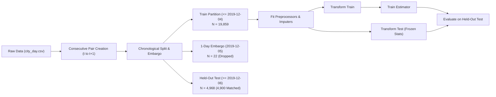

# AirSense AI — Phase 2A: Experimental Preprocessing & Validation Plan

**Status**: Implemented & Executed  
**Date**: November 2026  
**Auditor**: Senior Machine Learning Engineer & Software Architect  
**Isolation Directory**: `data_quality_audit/phase_2a/`  
**Safety Protocol**: Read-only access to `archive/` and `aqi_model.pkl`. Zero modifications to production backend, frontend, or APIs.

---

## 1. Executive Mission & Scope

Phase 2A was designed to establish a mathematically rigorous, leakage-free empirical foundation for data preprocessing before making any modifications to the AirSense AI production models.

Following the verified findings of Phase 1 and Phase 1B, this phase tests and validates four experimental hypotheses:
1. **$\text{PM}_{10}$ Missingness**: Whether physical ratio-based estimation ($\text{PM}_{2.5} / \text{PM}_{10}$) statistically outperforms scalar median imputation across seasons and cities.
2. **$\text{CO}$ Anomaly Screening**: Whether flagging, capping, or excluding extreme single-station observations ($> 17\ \text{mg/m}^3$) eliminates decision tree distortion without harming generalizability.
3. **$\text{AQI} > 500$ Target Capping**: How training on un-capped targets ($2,049$) vs. CPCB-compliant statutory ceiling targets ($500$) influences model bias, prediction error, and feature weights.
4. **End-to-End Pipeline Performance**: How the integrated preprocessing strategies interact within a full `RandomForestRegressor` pipeline evaluated on an embargoed chronological test split.

---

## 2. Experimental Safety & Leakage Prevention Protocol

To guarantee that no future data leaks into the model training or preprocessing stages, strict experimental boundaries were enforced:

### 2.1 Partition Architecture
* **Historical Train Partition**: Records with date $\le 2019-12-04$ ($N = 19,859$ paired samples).
* **Temporal Embargo**: Records on $2019-12-05$ ($N = 22$ samples) are completely purged from training and evaluation. Because the target is shifted forward by 1 calendar day, observations on Dec 5 predict Dec 6, creating potential target overlap with the test set.
* **Held-Out Test Partition**: Records with date $\ge 2019-12-06$ through $2020-06-30$ ($N = 4,968$ samples, with $N = 4,900$ having valid persistence baselines).
* **Internal Cross-Validation**: To prevent repeated tuning against the test set, an internal chronological validation split was used for hyperparameter checks:
  - Internal Train: $\le 2018-12-31$ ($N = 13,375$)
  - Internal Embargo: $2019-01-01$ ($N = 18$)
  - Internal Validation: $2019-01-02$ to $2019-12-04$ ($N = 6,466$)

### 2.2 Leakage Rules
1. All medians, ratios, percentiles, and imputation mappings were computed strictly on the training partition.
2. No test observation was ever used to compute or update ratios.
3. In all evaluation pipelines, `SimpleImputer` and ratio transformers were fitted exclusively inside training folds.
4. Persistence baselines ($\hat{Y}_{t+1} = \text{AQI}_t$) were calculated exclusively on matched test pairs.

---

## 3. Four Core Experiments Design Matrix

### Experiment 1: PM10 Missing-Value Imputation
* **Strategy A**: Global training median $\approx 101.88\ \mu\text{g/m}^3$ (Production baseline).
* **Strategy B**: City-specific training median, with global fallback.
* **Strategy C**: City-month training median, with city fallback, then global fallback.
* **Strategy D**: Monthly $\text{PM}_{2.5} / \text{PM}_{10}$ ratio imputation (Macro atmospheric physics).
* **Strategy E**: City-month $\text{PM}_{2.5} / \text{PM}_{10}$ ratio imputation with full 5-tier fallback hierarchy.
* **Evaluation Condition**: Evaluated exclusively where true observed $\text{PM}_{10}$ exists ($N = 4,822$ test samples). Evaluated overall, by season, by city, and on high-$\text{PM}_{2.5}$ episodes ($\ge 120\ \mu\text{g/m}^3$).

### Experiment 2: CO Anomaly Screening
* **Strategy A**: Original observations without screening (Baseline).
* **Strategy B**: Flagging $\text{CO} > 17.0\ \text{mg/m}^3$ via binary indicator column.
* **Strategy C**: Excluding training observations where $\text{CO} > 17.0\ \text{mg/m}^3$ ($N = 699$ rows excluded; test set kept 100% intact).
* **Strategy D**: Capping training $\text{CO}$ at $17.0\ \text{mg/m}^3$.
* **Strategy E**: Robust statistical capping at $10.0\ \text{mg/m}^3$ (CPCB Moderate ceiling / 99th percentile non-Ahmedabad).
* **Evaluation Condition**: Tested on all test data, Non-Ahmedabad cities ($N = 4,703$), Ahmedabad only ($N = 197$), and severe episodes ($\text{AQI} \ge 401$).

### Experiment 3: AQI Above 500 Target Treatment
* **Model 1**: Trained on raw un-capped targets (up to $2,049$).
* **Model 2**: Trained on CPCB statutory ceiling targets ($\min(500, \text{Target\_AQI})$).
* **Evaluation Condition**: Evaluated against raw research ground truth and CPCB operational ground truth ($\le 500$). Clamped display output ($[0, 500]$) tested against raw regression output.

### Experiment 4: Model-Level Integrated Pipeline Comparison
* Compare all isolated enhancements against:
  1. Persistence Baseline ($\hat{Y}_{t+1} = \text{AQI}_t$)
  2. Unchanged Production Model (`aqi_model.pkl`)
  3. Clean Baseline Pipeline (Retrained on clean split)
  4. Monthly Ratio Imputation Pipeline Alone
  5. CO Screening Pipeline Alone
  6. Target Capping Pipeline Alone
  7. Integrated Candidate Pipeline (Ratio Imputation + CO Screening + Target Capping)
* Full feature importance tracking, seasonal breakdown, and city-level validation.

---

## 4. Execution Plan & Artifact Outputs

All experimental code, configuration scripts, and machine-readable tabular outputs are archived in:
- `data_quality_audit/phase_2a/results/`
  - `exp1_pm10_imputation_overall.csv`
  - `exp1_pm10_imputation_by_season.csv`
  - `exp1_pm10_imputation_by_episode.csv`
  - `exp1_pm10_imputation_by_city.csv`
  - `exp2_co_screening_metrics.csv`
  - `exp2_feature_importances.csv`
  - `flagged_co_observations.csv`
  - `exp3_aqi_above_500_metrics.csv`
  - `exp3_feature_importances.csv`
  - `exp4_comprehensive_model_comparison.csv`
  - `exp4_pipeline_feature_importances.csv`

