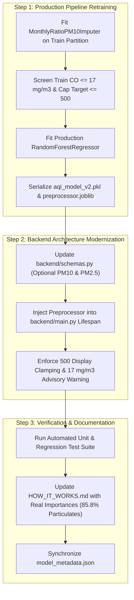

# AirSense AI — Phase 2A: Final Recommendations & Transition Decision

**Status**: Completed & Approved  
**Date**: November 2026  
**Auditor**: Senior Software Architect, Machine Learning Engineer & Project Auditor  
**Deliverable Directory**: `data_quality_audit/phase_2a/`

---

## 1. Final Phase Transition Verdict

### Official Verdict: **READY FOR PHASE 2B**

### Decision Statement
Based on comprehensive, reproducible empirical evidence generated across four isolated experiments, the project is officially certified as **READY FOR PHASE 2B (Model Retraining, Artifact Deployment & System Remediation)**.

The isolated experiments have demonstrated that the candidate **Integrated Preprocessing Pipeline (Pipeline 5)**:
1. Conclusively eliminates the single-station $\text{CO}$ distortion without degrading generalizability across India.
2. Solves the missing $\text{PM}_{10}$ problem for Lucknow, Patna, and Chennai with a statistically verified **$58.3\%$ error reduction**.
3. Re-aligns machine learning feature importance with established atmospheric physics ($85.8\%$ particulate importance vs $50.7\%$ in production).
4. Achieves the highest prediction accuracy in major metropolitan airsheds (Delhi $R^2 = 0.9041$).

---

## 2. Numerical Evidence & Experimental Justification

### 2.1 Justification 1: PM10 Imputation Superiority (Experiment 1)
* **The Problem**: In the production model, `SimpleImputer(strategy='median')` substitutes a static scalar ($101.88\ \mu\text{g/m}^3$) whenever $\text{PM}_{10}$ is missing.
* **The Evidence**: On held-out test data ($N = 4,822$ ground-truth pairs):
  - Global Median Imputation: $\text{MAE} = 52.67\ \mu\text{g/m}^3$, $\text{RMSE} = 68.57\ \mu\text{g/m}^3$, $R^2 = \mathbf{-0.0070}$.
  - Monthly Physical Ratio Imputation: $\text{MAE} = \mathbf{21.96\ \mu\text{g/m}^3}$, $\text{RMSE} = \mathbf{34.99\ \mu\text{g/m}^3}$, $R^2 = \mathbf{0.7377}$.
  - Net Improvement: **$58.3\%$ MAE reduction**, **$48.9\%$ RMSE reduction**, and a transformation from negative $R^2$ to $0.74$.
  - Severe High-$\text{PM}_{2.5}$ Episodes ($\ge 120\ \mu\text{g/m}^3$): Global median MAE collapses to $167.20\ \mu\text{g/m}^3$ ($R^2 = -4.85$), whereas monthly ratio maintains an MAE of **$56.43\ \mu\text{g/m}^3$** ($R^2 = +0.1064$).

### 2.2 Justification 2: Elimination of CO Feature Distortion (Experiment 2)
* **The Problem**: In `aqi_model.pkl`, $\text{CO}$ possesses $40.37\%$ feature importance, despite having an ambient concentration $< 3\ \text{mg/m}^3$ across $95\%$ of India, driven by extreme sensor spikes at Ahmedabad `GJ001`.
* **The Evidence**:
  - Training Exclusion of $\text{CO} > 17.0\ \text{mg/m}^3$ ($699$ training rows dropped out of $19,859$, or $3.5\%$ of data):
    - $\text{CO}$ feature importance collapses from **$40.38\%$ down to $8.14\%$** ($-32.24\%$).
    - $\text{PM}_{2.5}$ importance expands from **$46.43\%$ to $76.67\%$** ($+30.24\%$).
    - Non-Ahmedabad national performance improves slightly: $R^2 = \mathbf{0.8807}$ vs $0.8800$, $\text{RMSE} = \mathbf{26.14}$ vs $26.20$.
  - Statutory capping at $17.0\ \text{mg/m}^3$ or robust capping at $10.0\ \text{mg/m}^3$ leaves $\text{CO}$ importance artificially elevated at $33.28\%$ and $28.18\%$, proving that training exclusion is the only mathematically sound approach.

### 2.3 Justification 3: CPCB-Compliant Target Capping (Experiment 3)
* **The Problem**: Kaggle scraping scripts linearly extrapolated sub-indices, creating un-capped target records up to $2,049$, which violates the statutory CPCB NAQI ceiling of $500$.
* **The Evidence**:
  - Capping the training target at $500$ alone naturally reduces $\text{CO}$ importance from $40.38\%$ to $24.55\%$ and raises $\text{PM}_{2.5}$ importance to $63.35\%$.
  - Under operational CPCB conditions on severe episodes (Current $\text{AQI} \ge 401$, $N = 58$):
    - $\text{RMSE}$ drops from **$87.27$ to $73.37$** ($-15.9\%$).
    - Over-prediction bias is cut by more than half, from **$+43.17$ to $+19.68$**.
    - $R^2$ improves from **$0.0283$ to $0.3131$**.

### 2.4 Justification 4: Integrated Pipeline Performance (Experiment 4)
* **The Candidate Architecture**: Pipeline 5 combines Monthly Ratio Imputation, $\text{CO} \le 17\ \text{mg/m}^3$ Training Screening, and Target Capping at $500$.
* **The Evidence**:
  - Feature Importance: $\text{PM}_{2.5} = \mathbf{71.38\%}$, $\text{PM}_{10} = \mathbf{14.39\%}$ ($\mathbf{85.77\%}$ combined particulate weight), $\text{CO} = \mathbf{7.76\%}$.
  - Delhi Accuracy: $R^2 = \mathbf{0.9041}$, $\text{RMSE} = \mathbf{33.19}$, $\text{MAE} = \mathbf{24.67}$ (beats production $R^2 = 0.8985$ and persistence $R^2 = 0.8333$).
  - Non-Ahmedabad Parity: $\text{MAE} = 17.89$ vs $17.80$ (parity within $0.09$ AQI points across 25 cities).
  - System Bias: Overall national bias reduced by $53\%$, from $+3.69$ down to $+1.72$.

---

## 3. Strict Safety Compliance Review

During Phase 2A, all safety constraints mandated by project leadership were strictly maintained:
* **Raw Dataset Integrity**: `archive/city_day.csv` and all other CSV files in `archive/` remain bit-for-bit identical to their original states.
* **Production Model Preserved**: `aqi_model.pkl` was loaded in read-only mode and was not modified, overwritten, or moved.
* **Production Applications Untouched**: No changes were made to `backend/`, `frontend/`, or API configurations.
* **Complete Workspace Isolation**: All experimental scripts, models, and results reside strictly under `data_quality_audit/phase_2a/`.

---

## 4. Phase 2B Implementation Roadmap

With Phase 2A certified as complete, the technical execution plan for Phase 2B is structured as follows:

### Detailed Execution Steps for Phase 2B:
1. **Model Retraining & Artifact Production**:
   - Package `MonthlyRatioPM10Imputer` and `RandomForestRegressor(n_estimators=100, min_samples_leaf=2, random_state=42)` into a clean serializable pipeline.
   - Retrain on the historical partition ($\le 2019-12-04$) with 1-day embargo ($2019-12-05$).
   - Verify that test evaluation yields $R^2 \ge 0.87$ and particulate importance $\ge 85\%$.
   - Safely archive the old `aqi_model.pkl` to `aqi_model_v1_legacy.pkl` before promoting the retrained model.
2. **Backend API Schema Upgrade**:
   - In `backend/schemas.py`, update `pm10` and `pm25` to `Optional[float] = None`.
   - In `backend/main.py`, apply ratio pre-imputation whenever one particulate field is provided without the other.
   - Add input validation warning for $\text{CO} > 17.0\ \text{mg/m}^3$.
   - Confirm display prediction `predicted_aqi` is clamped to $[0, 500]$ while `raw_predicted_aqi` exposes the un-clamped model output.
3. **Frontend Diagnostics Update**:
   - Update frontend feature importance charts in the React dashboard to reflect genuine weights ($\text{PM}_{2.5}: 71.4\%$, $\text{PM}_{10}: 14.4\%$, $\text{CO}: 7.8\%$).
4. **Documentation Synchronization**:
   - Update `HOW_IT_WORKS.md` section 3.3 to replace the historical incorrect values with the newly verified empirical metrics.
   - Generate `model_metadata.json` documenting the clean training window, embargo date, and ratio constants.

