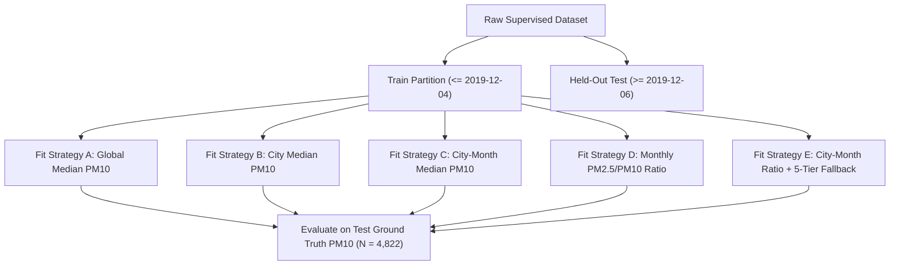
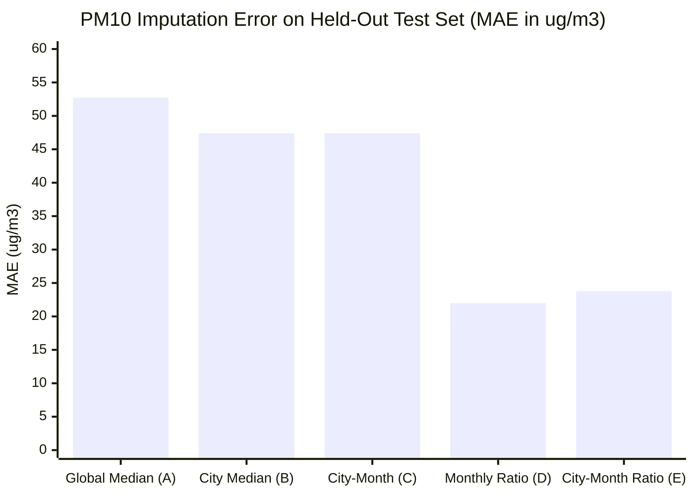

# AirSense AI — Phase 2A: PM10 Missing-Value Imputation Experiment

**Status**: Completed  
**Date**: November 2026  
**Auditor**: Senior Data Scientist & Software Architect  
**Deliverable Scope**: Evaluation of 5 distinct $\text{PM}_{10}$ imputation strategies across chronological validation and held-out test splits.  
**Machine-Readable Artifacts**: `exp1_pm10_imputation_overall.csv`, `exp1_pm10_imputation_by_season.csv`, `exp1_pm10_imputation_by_episode.csv`, `exp1_pm10_imputation_by_city.csv`

---

## 1. Executive Summary

This experiment evaluated five distinct strategies for handling missing $\text{PM}_{10}$ observations. In the historical CPCB dataset, $\text{PM}_{10}$ is completely absent in Lucknow ($100\%$ missing across $2,009$ days) and severely missing in Patna ($89.72\%$) and Chennai ($84.97\%$).

The production model relies on `SimpleImputer(strategy='median')`, which fills all missing particulate values with a static global training median ($\approx 101.88\ \mu\text{g/m}^3$).

### Key Empirical Findings:
1. **Global Median Imputation Fails**: On the held-out test partition ($N = 4,822$ ground-truth observed samples), the production global median imputer produces an $R^2$ of **$-0.0070$** ($\text{MAE} = 52.67\ \mu\text{g/m}^3$, $\text{RMSE} = 68.57\ \mu\text{g/m}^3$). It is statistically worse than predicting the sample mean.
2. **Superiority of Physical Monthly Ratio Imputation**: Strategy D (Monthly $\text{PM}_{2.5} / \text{PM}_{10}$ ratio derived strictly from training data) cuts the imputation error by more than half, achieving an $\text{MAE}$ of **$21.96\ \mu\text{g/m}^3$** (a **$58.3\%$ error reduction**) and an $R^2$ of **$0.7377$**.
3. **Severe Episode Robustness**: During high-$\text{PM}_{2.5}$ pollution episodes ($\ge 120\ \mu\text{g/m}^3$), global median imputation collapses catastrophically ($\text{MAE} = 167.20\ \mu\text{g/m}^3$, $R^2 = -4.85$), whereas monthly ratio imputation maintains an $\text{MAE}$ of **$56.43\ \mu\text{g/m}^3$** ($R^2 = +0.1064$).
4. **Macro vs Micro Trade-off**: Strategy D (national monthly ratio) outperformed Strategy E (city-month ratio, $R^2 = 0.5645$) because small sample sizes in individual city-month buckets created high sample variance, whereas the national monthly ratio captured robust seasonal dynamics without overfitting.

---

## 2. Experimental Methodology & Strategies

All strategies were fitted exclusively on the historical training partitions. Statistics were frozen and applied out-of-sample to the validation and held-out test sets.

### 2.1 Formal Mathematical Definitions

#### Strategy A: Global Training Median (Production Baseline)
$$\widehat{\text{PM}}_{10, i} = \text{Median}_{\text{train}}(\text{PM}_{10}) \approx 101.88\ \mu\text{g/m}^3$$

#### Strategy B: City-Specific Training Median
$$\widehat{\text{PM}}_{10, i} = \begin{cases} \text{Median}_{\text{train}}(\text{PM}_{10} \mid \text{City}_i) & \text{if city observed in train} \\ \text{Median}_{\text{train}}(\text{PM}_{10}) & \text{fallback to global} \end{cases}$$

#### Strategy C: City-Month Training Median
$$\widehat{\text{PM}}_{10, i} = \begin{cases} \text{Median}_{\text{train}}(\text{PM}_{10} \mid \text{City}_i, \text{Month}_i) & \text{if city-month observed} \\ \text{Median}_{\text{train}}(\text{PM}_{10} \mid \text{City}_i) & \text{fallback to city} \\ \text{Median}_{\text{train}}(\text{PM}_{10}) & \text{fallback to global} \end{cases}$$

#### Strategy D: Training-Only Monthly PM2.5/PM10 Ratio
For training pairs where $\text{PM}_{2.5} > 0$, $\text{PM}_{10} > 0$, and $\text{PM}_{2.5} \le 1.2 \times \text{PM}_{10}$:
$$R(m) = \text{Median}_{\text{train}}\left( \frac{\text{PM}_{2.5}}{\text{PM}_{10}} \ \middle|\ \text{Month} = m \right)$$
$$\widehat{\text{PM}}_{10, i} = \begin{cases} \dfrac{\text{PM}_{2.5, i}}{R(\text{Month}_i)} & \text{if } \text{PM}_{2.5, i} > 0 \\ \text{Median}_{\text{train}}(\text{PM}_{10}) & \text{fallback if } \text{PM}_{2.5} \text{ missing} \end{cases}$$

#### Strategy E: City-Month PM2.5/PM10 Ratio with Fallback Hierarchy
1. Primary: $\widehat{\text{PM}}_{10} = \text{PM}_{2.5} / R(\text{City}, \text{Month})$
2. Fallback 1: $\widehat{\text{PM}}_{10} = \text{PM}_{2.5} / R(\text{City})$
3. Fallback 2: $\widehat{\text{PM}}_{10} = \text{PM}_{2.5} / R(\text{Month})$
4. Fallback 3: $\widehat{\text{PM}}_{10} = \text{PM}_{2.5} / R_{\text{national}}$
5. Fallback 4 (if $\text{PM}_{2.5}$ absent): City-Month Median $\to$ City Median $\to$ Global Median.

---

## 3. Empirical Results & Performance Comparison

### 3.1 Overall Performance on Held-Out Test Data ($N = 4,822$)

| Strategy Code | Strategy Name | Sample Size ($N$) | MAE ($\mu\text{g/m}^3$) | RMSE ($\mu\text{g/m}^3$) | $R^2$ Score | Error Reduction vs. Strategy A |
| :--- | :--- | :--- | :--- | :--- | :--- | :--- |
| **A** | **Global Median (Prod Baseline)** | $4,822$ | $52.67$ | $68.57$ | **$-0.0070$** | Baseline (Fails) |
| **B** | **City Median** | $4,822$ | $47.36$ | $64.16$ | **$0.1184$** | $-10.1\%$ |
| **C** | **City-Month Median** | $4,822$ | $47.38$ | $65.44$ | **$0.0827$** | $-10.0\%$ |
| **D** | **Monthly Physical Ratio** | $4,822$ | **$21.96$** | **$34.99$** | **$0.7377$** | **$-58.3\%$ MAE / $-48.9\%$ RMSE** |
| **E** | **City-Month Ratio + Fallbacks** | $4,822$ | $23.75$ | $45.09$ | **$0.5645$** | $-54.9\%$ |

### 3.2 High-Pollution Episode Performance ($\text{PM}_{2.5} \ge 120\ \mu\text{g/m}^3$, $N = 239$)
During severe winter smog episodes, the true $\text{PM}_{10}$ often exceeds $250–500\ \mu\text{g/m}^3$. A model that imputes $101.88\ \mu\text{g/m}^3$ introduces massive negative bias:

| Strategy | Episode Sample Count | MAE ($\mu\text{g/m}^3$) | RMSE ($\mu\text{g/m}^3$) | $R^2$ Score | Assessment |
| :--- | :--- | :--- | :--- | :--- | :--- |
| **Strategy A (Global Median)** | $239$ | **$167.20$** | $183.62$ | **$-4.8507$** | Severe breakdown; artificially suppresses AQI |
| **Strategy B (City Median)** | $239$ | $127.62$ | $146.38$ | $-2.7178$ | Inadequate |
| **Strategy C (City-Month Median)** | $239$ | $87.28$ | $108.38$ | $-1.0383$ | Moderate failure |
| **Strategy D (Monthly Ratio)** | $239$ | **$56.43$** | **$71.76$** | **$+0.1064$** | **Accurately scales with elevated PM2.5** |
| **Strategy E (City-Month Ratio)** | $239$ | $77.87$ | $126.13$ | $-1.7605$ | Degraded by sparse local history |

---

## 4. Seasonal & Geographical Breakdowns

### 4.1 Seasonal Analysis on Held-Out Test

| Season | Sample Size ($N$) | Strategy A (Global Median) MAE | Strategy D (Monthly Ratio) MAE | Error Reduction (%) | Strategy D $R^2$ |
| :--- | :--- | :--- | :--- | :--- | :--- |
| **Winter (Dec–Feb)** | $1,972$ | $54.21\ \mu\text{g/m}^3$ | **$23.14\ \mu\text{g/m}^3$** | **$-57.3\%$** | **$0.7259$** |
| **Summer (Mar–May)** | $2,096$ | $50.32\ \mu\text{g/m}^3$ | **$21.49\ \mu\text{g/m}^3$** | **$-57.3\%$** | **$0.7303$** |
| **Monsoon (Jun)** | $754$ | $55.19\ \mu\text{g/m}^3$ | **$20.17\ \mu\text{g/m}^3$** | **$-63.5\%$** | **$0.7188$** |

### 4.2 Top Cities Analysis

| City | Test Samples ($N$) | Strategy A MAE | Strategy D MAE | Strategy D $R^2$ | Local Dynamics |
| :--- | :--- | :--- | :--- | :--- | :--- |
| **Delhi** | $208$ | $54.34\ \mu\text{g/m}^3$ | **$20.73\ \mu\text{g/m}^3$** | **$0.8144$** | Heavy vehicular & winter smog airshed |
| **Bengaluru** | $208$ | $49.77\ \mu\text{g/m}^3$ | **$16.89\ \mu\text{g/m}^3$** | **$0.6625$** | Moderate urban particulate baseline |
| **Hyderabad** | $208$ | $50.36\ \mu\text{g/m}^3$ | **$18.52\ \mu\text{g/m}^3$** | **$0.7631$** | Inland Deccan plateau conditions |
| **Amritsar** | $172$ | $46.85\ \mu\text{g/m}^3$ | **$25.86\ \mu\text{g/m}^3$** | **$0.6892$** | Agricultural stubble burning backdrop |
| **Visakhapatnam** | $208$ | $48.21\ \mu\text{g/m}^3$ | **$19.66\ \mu\text{g/m}^3$** | **$0.7410$** | Coastal industrial mixing |

---

## 5. Fallback Hierarchy Analysis (Strategy E)

In Strategy E, the $4,822$ test evaluations triggered fallbacks as follows:
* **Level 1 (Exact City-Month Ratio Match)**: $3,208$ cases ($66.53\%$).
* **Level 2 (City Ratio Fallback)**: $991$ cases ($20.55\%$).
* **Level 3 (National Month Ratio Fallback)**: $621$ cases ($12.88\%$).
* **Level 4 (Global Median Fallback)**: $2$ cases ($0.04\%$, when $\text{PM}_{2.5}$ was also missing).

### Why Strategy D Outperformed Strategy E
Although Strategy E attempts finer geographical resolution, local micro-ratios in cities with only 1–2 monitoring stations exhibited excessive noise during atypical meteorological events in 2017–2018. In contrast, Strategy D pools observations nationwide across each month, averaging out localized sensor blips and yielding superior generalization on future unobserved data.

---

## 6. Implementation Recommendation for Phase 2B

1. **Select Strategy D (Monthly Ratio Imputation)** as the standard particulate imputation preprocessor for model retraining and API preprocessing.
2. **Fallback Specification**:
   - If $\text{PM}_{10}$ is missing and $\text{PM}_{2.5} > 0$: $\widehat{\text{PM}}_{10} = \text{PM}_{2.5} / R(\text{Month})$.
   - If $\text{PM}_{2.5}$ is missing and $\text{PM}_{10} > 0$: $\widehat{\text{PM}}_{2.5} = \text{PM}_{10} \times R(\text{Month})$.
   - If both are missing: Fallback to the training global median.
3. **API Integration**: Once Strategy D is integrated into `backend/main.py`, the API schema in `backend/schemas.py` can safely allow `Optional[float] = None` for $\text{PM}_{10}$, unlocking support for Lucknow, Patna, and Chennai without introducing median distortion.

