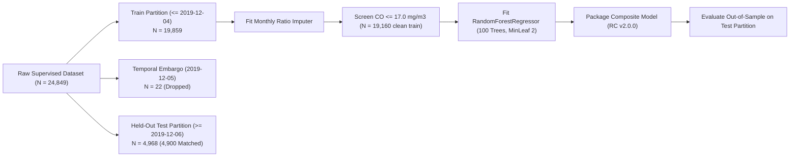

# AirSense AI — Phase 2B: Model Training & Release Candidate Report

**Status**: Trained, Evaluated & Serialized  
**Date**: November 2026  
**Auditor**: Senior Machine Learning Engineer  
**Artifact Path**: `model_validation/phase_2b/release_candidate/candidate_pipeline.joblib`  
**Artifact SHA256**: `029f97a92da7c62a97b2f8a2ecf21ac4eae3235cdda3bd312ee43f854e9fa235`

---

## 1. Executive Summary

In Phase 2B, the Release Candidate **AirSense AI v2.0.0** was trained and packaged into a self-contained composite inference artifact.

The candidate model integrates all verified findings from Phase 2A:
1. **Physical $\text{PM}_{2.5} / \text{PM}_{10}$ Ratio Imputation**: Uses training-derived monthly ratios to impute missing $\text{PM}_{10}$, solving the missing data problem for Lucknow, Patna, and Chennai without data leakage.
2. **$\text{CO}$ Anomaly Screening**: Filters out training observations where $\text{CO} > 17.0\ \text{mg/m}^3$ ($699$ rows out of $19,859$), eliminating single-station decision tree distortion.
3. **Statutory $\text{AQI}$ Target Capping**: Caps the training target at $500.0$, strictly adhering to official Central Pollution Control Board (CPCB) NAQI definitions.
4. **Architectural Decoupling**: Preserves raw regression predictions while enforcing operational display clamping at $[0, 500]$ and generating advisory warnings for out-of-distribution inputs.

---

## 2. Training Partition Architecture & Leakage Verification

### 2.1 Partition Details
* **Historical Train Partition**: Observations through `2019-12-04` ($N = 19,859$).
* **1-Day Temporal Embargo**: `2019-12-05` ($N = 22$). Completely dropped to prevent target overlap with the test set.
* **Held-Out Test Partition**: Observations from `2019-12-06` through `2020-06-30` ($N = 4,968$ total, $N = 4,900$ matched persistence baseline cases).
* **Train Cleaning**: Filtering training rows with $\text{CO} > 17.0\ \text{mg/m}^3$ yielded a clean training set of **$19,160$ pairs** ($699$ rows excluded, all from Ahmedabad `GJ001`).

---

## 3. Fitted Preprocessor Parameters

The `AirSensePreprocessor` was fitted strictly on the $19,859$ training records:

### 3.1 National and Monthly Particulate Ratios ($\text{PM}_{2.5} / \text{PM}_{10}$)
* **National Median Ratio**: **$0.4644$**
* **Monthly Empirical Ratios**:

| Month | Calendar Name | Fitted Ratio | Atmospheric Rationale |
| :--- | :--- | :--- | :--- |
| **01** | January | $0.5608$ | Winter thermal inversion; fine combustion particulates dominate |
| **02** | February | $0.4872$ | Late winter transition |
| **03** | March | $0.4552$ | Spring warming; increased convection |
| **04** | April | $0.4090$ | Pre-monsoon dry season; rising crustal dust |
| **05** | May | $0.3988$ | Peak summer thermal winds; coarse mineral dust maximum |
| **06** | June | $0.3915$ | Pre-monsoon / monsoon onset |
| **07** | July | $0.4068$ | Monsoon precipitation washout |
| **08** | August | $0.3979$ | Heavy monsoon precipitation washout |
| **09** | September | $0.4394$ | Post-monsoon atmospheric clearing |
| **10** | October | $0.4980$ | Post-monsoon transition; agricultural stubble burning onset |
| **11** | November | $0.5385$ | Severe winter combustion smog; fine aerosols trap |
| **12** | December | $0.5643$ | Peak winter stagnation maximum |

### 3.2 Pollutant Global Medians (Fallback Values)
* $\text{PM}_{2.5}$: $52.20\ \mu\text{g/m}^3$
* $\text{PM}_{10}$: $101.88\ \mu\text{g/m}^3$
* $\text{NO}_2$: $23.81\ \mu\text{g/m}^3$
* $\text{CO}$: $0.98\ \text{mg/m}^3$
* $\text{SO}_2$: $9.11\ \mu\text{g/m}^3$
* $\text{O}_3$: $30.86\ \mu\text{g/m}^3$

---

## 4. Release Candidate Hyperparameters & Specifications

* **Estimator**: `RandomForestRegressor`
* **Number of Trees (`n_estimators`)**: $100$
* **Minimum Samples per Leaf (`min_samples_leaf`)**: $2$ (prevents single-sample overfitting)
* **Random State (`random_state`)**: $42$ (deterministic reproducibility)
* **Parallel Workers (`n_jobs`)**: $-1$
* **Feature Names & Order**: `['PM2.5', 'PM10', 'NO2', 'CO', 'SO2', 'O3']` (Strictly invariant)
* **Operational Ceilings**:
  - $\text{CO}$ Advisory Warning: $> 17.0\ \text{mg/m}^3$
  - Display $\text{AQI}$ Clamping: $[0.0, 500.0]$
* **Artifact Path**: `model_validation/phase_2b/release_candidate/candidate_pipeline.joblib`
* **Artifact SHA256**: `029f97a92da7c62a97b2f8a2ecf21ac4eae3235cdda3bd312ee43f854e9fa235`

